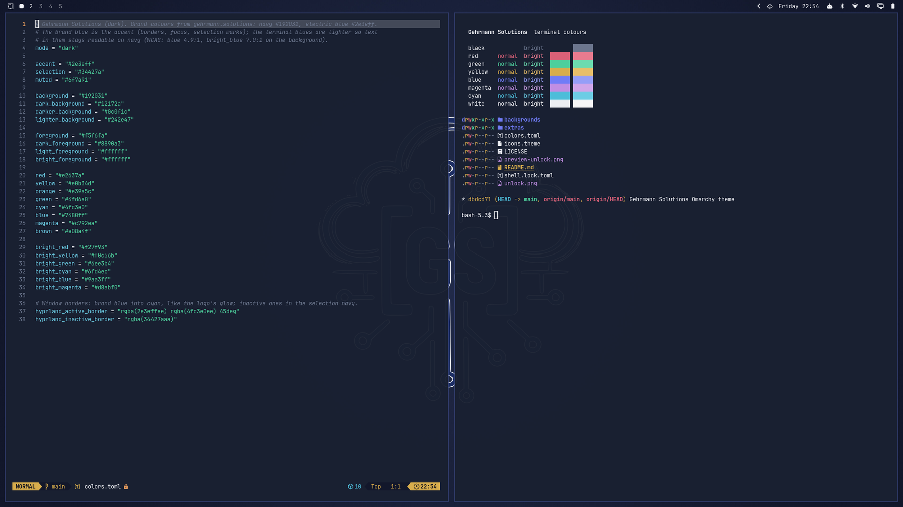

# Gehrmann Solutions — Omarchy theme

A dark [Omarchy](https://omarchy.org) theme in the colours of
[gehrmann.solutions](https://gehrmann.solutions): deep navy, one electric-blue accent and the
GS cloud-and-circuit logo with a neon glow.



```bash
omarchy theme install https://github.com/GehrmannSolutions/omarchy-gehrmann-solutions-theme.git
```

The light variant is
[Gehrmann Solutions Light](https://github.com/GehrmannSolutions/omarchy-gehrmann-solutions-light-theme).

## Palette

| Role | Colour | |
|---|---|---|
| Background | `#192031` | navy, the site's dark sections |
| Foreground | `#f5f6fa` | near-white |
| Accent | `#2e3eff` | the brand blue: borders, focus, lock field |
| Selection | `#34427a` | |
| Terminal blue | `#7480ff` / bright `#9aa3ff` | lighter than the brand blue so text in it stays readable on navy (4.9:1 and 7.0:1) |

Window borders run from the brand blue into cyan (`hyprland_active_border` in `colors.toml`).
The other terminal colours are cool, slightly desaturated hues; every one reads at 4.8:1 or
more on the background.

## What is in it

| File | Used for |
|---|---|
| `colors.toml` | the palette; Omarchy generates the terminal, editor, btop, browser and shell colours from it |
| `backgrounds/` | 1 logo with glow (default), 2 logo, 3 logo in brand blue, 4 the site's dot sunburst, 5 plain navy |
| `unlock.png` | the logo on the boot and disk-unlock screen (Plymouth): *Style › Unlock* in the Omarchy menu, or `omarchy plymouth set-by-theme gehrmann-solutions` |
| `shell.lock.toml` | lock screen password field: brand-blue frame, cyan while typing |
| `icons.theme` | `Yaru-blue-dark` (package `yaru-icon-theme`) |
| `preview.png`, `preview-unlock.png` | the theme picker's previews |

## Extras (optional)

**Logo on the lock screen.** Omarchy's lock screen has no theme hook for a logo, so
`extras/gs-lock-logo` clones the built-in lock plugin with Omarchy's own
`omarchy plugin clone omarchy.lock` and adds the current theme's `unlock.png` above the password
field. A post-update hook rebuilds the clone from the current built-in plugin after every Omarchy
update, so it never keeps an outdated lock screen; if the built-in one changes in a way the patch
does not recognise, the clone is removed and the built-in lock is used.

```bash
~/.config/omarchy/themes/gehrmann-solutions/extras/gs-lock-logo install
omarchy-shell lock preview      # look at it without locking; omarchy-shell lock hidePreview
gs-lock-logo remove             # back to the built-in lock screen
```

It shows whichever theme is active, so it also works with the light variant (and with any theme
that has an `unlock.png`).

**Screensaver artwork.** `extras/screensaver.txt` is the logo as circuit-style text art for
Omarchy's screensaver:

```bash
cp ~/.config/omarchy/themes/gehrmann-solutions/extras/screensaver.txt ~/.config/omarchy/branding/screensaver.txt
```

## Building

The images are generated from the logo SVG by `tools/build.sh` in
[GehrmannSolutions/Omarchy](https://github.com/GehrmannSolutions/Omarchy/tree/main/Themes/gehrmann-solutions),
which builds this theme and the light variant together. Edit there, not here.

## Licence

See [LICENSE](LICENSE).
